# HELIX — app inspection

Version: Android preview build #7 / web build from branch `ccr-8d17e0b5-yaqvtm` (code at commit `f46e701`), 23 November 2026. Screenshots are real captures of this build on a Pixel 7–sized screen.

**What HELIX is:** a mobile-first crypto app with five areas — Home, Markets, Bot, Wallet, More. Users can follow live markets, practise trading with a **paper account** (simulated money at live prices with modelled fees), use a **self-custody testnet wallet**, and see what the **Trading Bot** research engine found. **Real-money trading is disabled**; the code contains no exchange order functions.

**Links:** [Open the live app](https://cupidamorstore.github.io/helix-preview/) (needs JavaScript; data is stored only in your own browser. Until the Pages deployment for this branch is enabled, that address still shows an older build.) · [Source code](https://github.com/CupidAmorstore/helix-preview/tree/ccr-8d17e0b5-yaqvtm) · [QA report](https://github.com/CupidAmorstore/helix-preview/blob/ccr-8d17e0b5-yaqvtm/docs/APP_QA_REPORT.md) · [Android APK (debug)](https://github.com/CupidAmorstore/helix-preview/releases/tag/android-preview)

## Navigation

| Bottom tab | Route | Contains |
|---|---|---|
| Home | `/` | Paper account, positions, movers, watchlist, bot summary, recent activity, watched addresses |
| Markets | `/markets`, `/markets/:symbol` | Search and lists; coin pages with chart, stats and paper buy/sell |
| Bot | `/bot`, `/bot/research` | Overview, Strategies, Activity; advanced Research Lab |
| Wallet | `/wallet` | Self-custody guide, create/import, accounts, receive, history, checked sends |
| More | `/more` | Holdings (watched addresses), Price alerts, Connections & vault, Help & legal |

## Screens

### Home — first visit

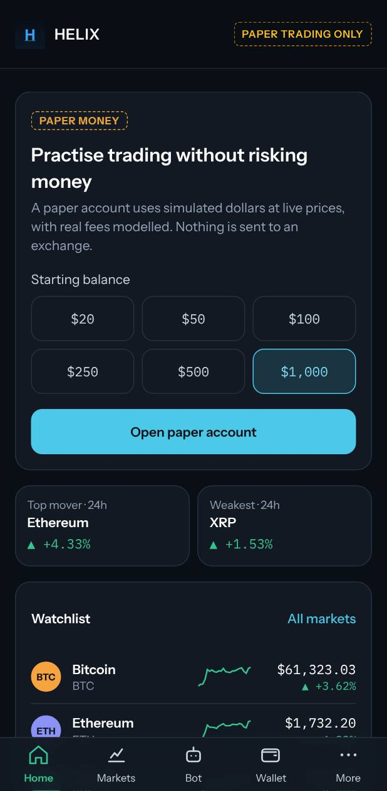

Explains paper trading and asks for a starting balance: $20, $50, $100, $250, $500 or $1,000 of simulated money. One button opens the account. Below: watchlist with live prices, bot summary.

Source: [HomePage.tsx](https://github.com/CupidAmorstore/helix-preview/blob/ccr-8d17e0b5-yaqvtm/src/pages/HomePage.tsx)

### Home — with a paper account

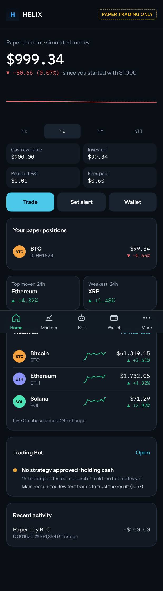

- Account value and profit/loss since start (sign and arrow, not colour alone)
- Value chart with 1D / 1W / 1M / All (valued about hourly; minimum 2% vertical range so tiny fee moves don't look like crashes)
- Cash available, invested, realized P&L, fees paid
- Paper positions with value and P&L; top and weakest mover (24h); watchlist with live price, 24h change and 24h sparkline
- Trading Bot status, recent paper orders (including refused ones), and watched addresses (only shown if the user tracks some)

In this capture: $1,000 account after a $100 paper buy of BTC. Small loss = 0.60% fee + spread.

### Markets

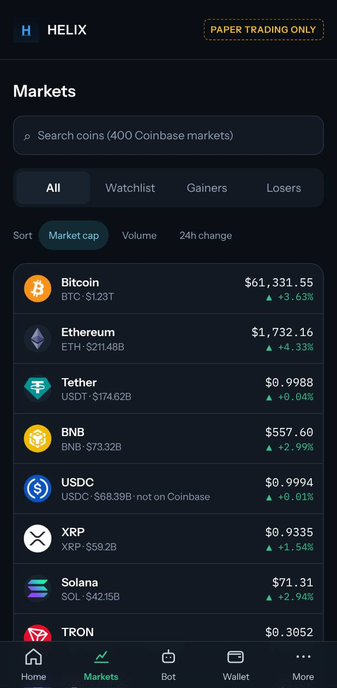

- Search across Coinbase's ~400 USD markets plus CoinGecko's top 100
- Lists: All, Watchlist, Gainers, Losers; sort by market cap, volume or 24h change
- Each row: logo, name, market cap, price, 24h change; "not on Coinbase" marked
- Footer states the source and age of the list; on rate limits a saved copy is shown with its age

Data: CoinGecko (list), Coinbase Exchange WebSocket (live prices for main coins). Not yet available: network filters, DEX pools, new-listing feed.

### Coin page (e.g. Bitcoin)

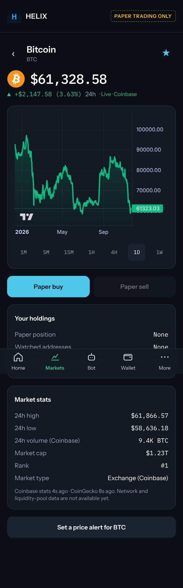

- Live price with 24h change in $ and %, feed status (Live / Reconnecting / Delayed)
- Chart with 1m, 5m, 15m, 1h, 4h, 1d, 1w (4h and 1w built from complete Coinbase candles)
- Paper buy / Paper sell; watch ☆; "Set a price alert" (pre-selects the coin)
- Your holdings: paper position (value, cost, unrealized P&L) kept separate from watched read-only addresses
- Market stats: 24h high/low/volume (Coinbase), market cap and rank (CoinGecko), market type, data ages

Source: [AssetPage.tsx](https://github.com/CupidAmorstore/helix-preview/blob/ccr-8d17e0b5-yaqvtm/src/pages/AssetPage.tsx)

### Paper order ticket

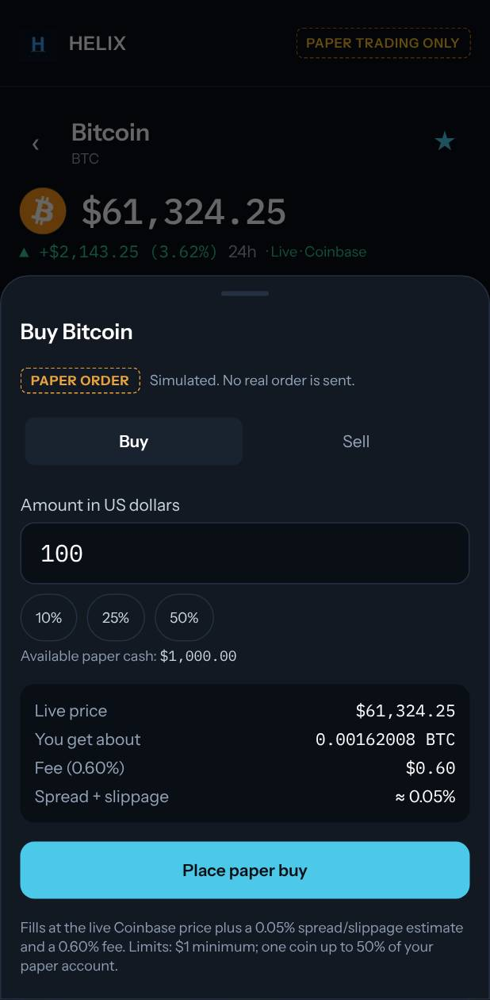

Bottom sheet labelled **PAPER ORDER — no real order is sent**. Buy in dollars or sell in coins, quick amounts, and a preview before confirming: live price, coins received, 0.60% fee, ≈0.05% spread + slippage.

**Rules enforced** ([engine.ts](https://github.com/CupidAmorstore/helix-preview/blob/ccr-8d17e0b5-yaqvtm/src/paper/engine.ts), 10 unit tests): $1 minimum; one coin at most 50% of the account; not more than available cash; prices older than 60 s refused; duplicate submits ignored (one ticket id per opening); pause switch blocks orders; every order, filled or refused, is logged with a reason.

### Paper fill confirmation

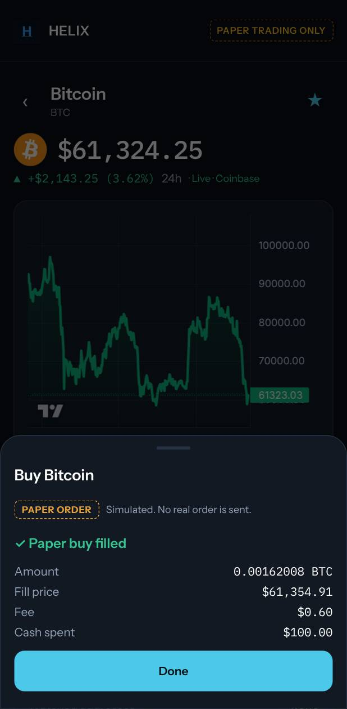

Shows amount, fill price, fee and cash spent (or received and realized P&L for sells). Verified end to end: $100 buy → cash $900.00, fee $0.60; selling all at an almost unchanged price realized −$1.23 (two fees + spread).

### Bot — Overview

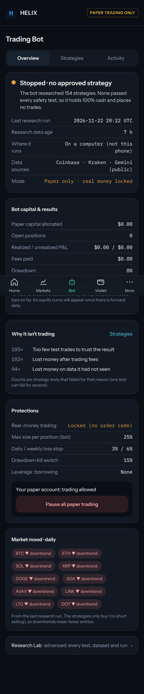

- Status: **Stopped · no approved strategy**. The research engine tested 154 strategy variants on 10 coins; none passed every test, so it holds cash and trades nothing.
- Last research run, data age, where it runs (a computer, not the phone), data sources, mode (paper only; real money locked)
- Bot capital and P&L: all zero, explained as "has not traded", not "broke even"
- Why it isn't trading: plain-language reasons with counts (e.g. too few test trades to trust, lost money after fees)
- Protections: position size, daily/weekly loss stops, drawdown kill switch, no leverage; working pause switch for the paper account
- Market mood from the last run; link to the Research Lab

### Bot — Strategies

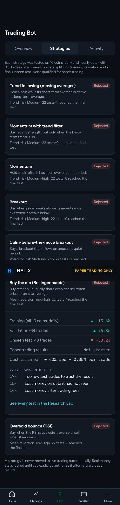

Seven strategies in plain language: trend following, momentum with trend filter, momentum, breakout, calm-before-the-move breakout, buy the dip (Bollinger), oversold bounce (RSI). Each shows objective, style, risk class, number of tests and, when opened, results across all 10 coins on daily data — training, validation and the final unseen test, with trade counts — plus costs assumed and why it was rejected.

Example: "Buy the dip" made +6.8% in validation but lost 38.2% on the unseen test (49 trades). All 7 are rejected; none is promoted automatically.

### Bot — Activity

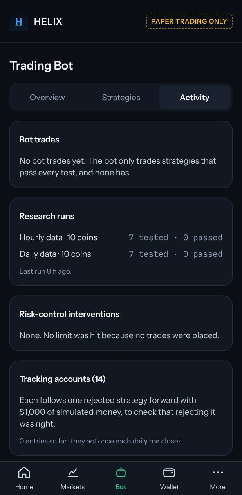

Bot trades (none), research runs (hourly and daily data, tested and passed counts), risk-control interventions (none) and 14 tracking accounts that follow rejected strategies forward to check the decisions.

### Research Lab (advanced)

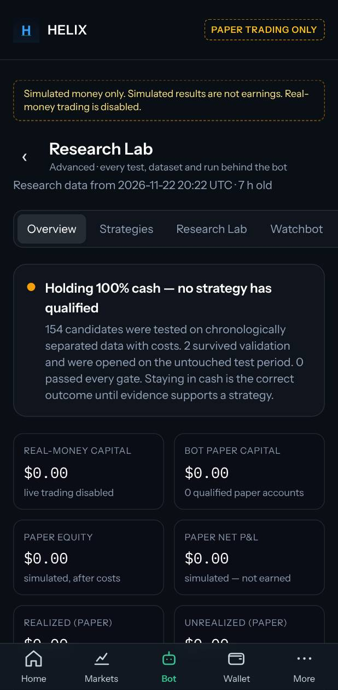

The full research record: every candidate with train/validation/test metrics, datasets with quality scores, run assumptions, cross-exchange price check, risk tables and account-size feasibility ($20–$1,000). Source: [src/bot](https://github.com/CupidAmorstore/helix-preview/tree/ccr-8d17e0b5-yaqvtm/src/bot) (walk-forward validation, cost stress, Bonferroni-adjusted bootstrap) and [research/](https://github.com/CupidAmorstore/helix-preview/tree/ccr-8d17e0b5-yaqvtm/research) (stored datasets and run records).

### Wallet — first visit

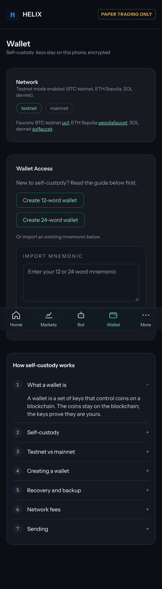

Testnet by default (mainnet behind an explicit consent step). A 7-step guide explains what a wallet is, self-custody, testnet vs mainnet, creation, recovery and backup, network fees and sending. Create a 12/24-word wallet (with word verification) or import one; keys are encrypted with the vault password (Argon2id + AES-GCM) and stay on the device.

### Wallet — accounts and sending

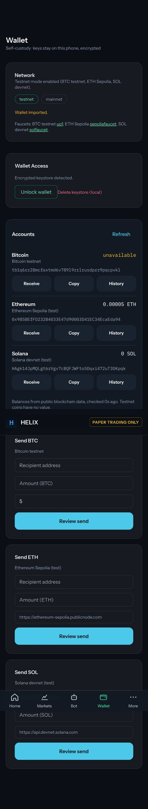

- Bitcoin, Ethereum and Solana accounts with the network named (e.g. "Ethereum Sepolia (test)"), live balances from public blockchain data, Receive, Copy and History
- Sending is checked before anything is signed ([walletSafety.ts](https://github.com/CupidAmorstore/helix-preview/blob/ccr-8d17e0b5-yaqvtm/src/services/walletSafety.ts), 6 tests): address valid for the chain *and* network (a mainnet address is refused on testnet and vice versa); the RPC server's chain is verified (Ethereum chain id, Solana genesis hash); a review step shows amount, network and recipient before "Confirm send"

This capture uses the public BIP-39 test phrase ("abandon … about"); never use it for real funds.

### Wallet — Receive

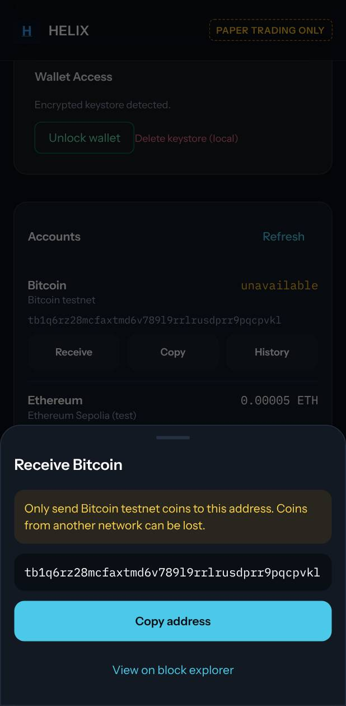

Full address, a warning to send only coins from the named network, Copy address, and a block-explorer link. History lists recent transactions (Bitcoin via Blockstream, Solana via RPC; Ethereum via an explorer link).

### More

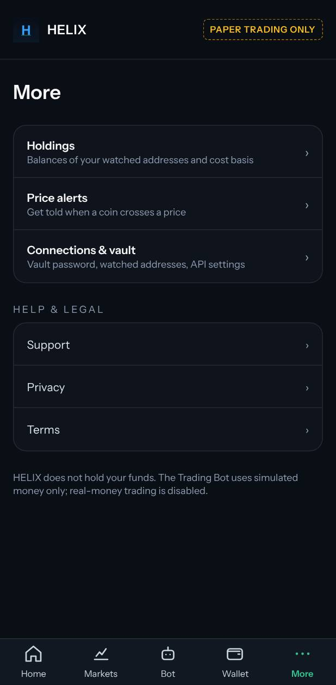

Holdings (watched public addresses, read-only, with cost basis — P&L only once a cost basis is entered), Price alerts, Connections & vault (vault password, watched addresses, optional API keys for Etherscan/RPC), Help & legal.

### Price alerts

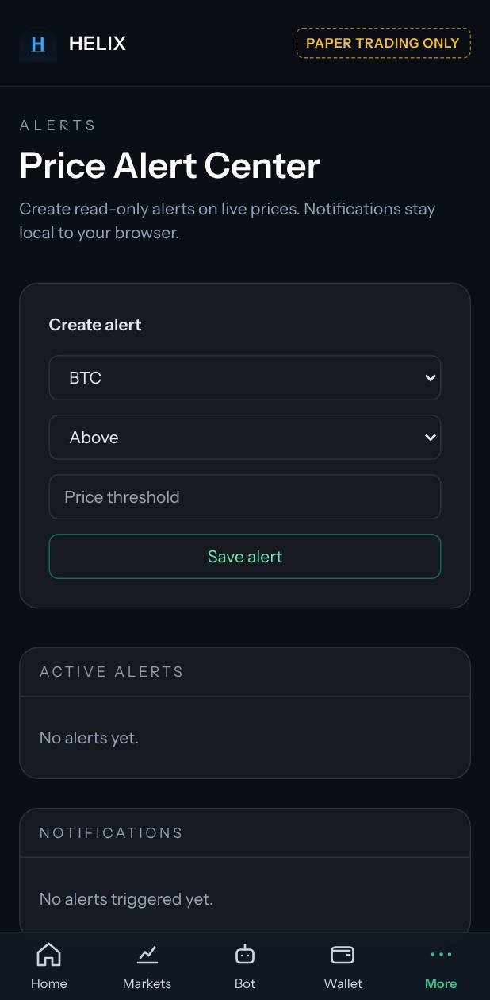

Create above/below alerts on the main coins. **Limitation:** alerts trigger only while the app is open; background phone notifications are not implemented yet.

## Design system

Dark ink surfaces (#0A0E15 / #121923 / #19222F), one accent (Helix Cyan #4CC9E8), semantic up #35C48F / down #F26E6E / paper #E9A33C. Instrument Sans for text; IBM Plex Mono with tabular figures for every number. Every change shows a sign and ▲/▼. Shared components in [ui.tsx](https://github.com/CupidAmorstore/helix-preview/blob/ccr-8d17e0b5-yaqvtm/src/components/ui.tsx).

## Testing evidence

- 84 automated tests (Vitest): paper engine, wallet derivation vectors (BIP84, Ethereum), wallet send checks, market data, feed reconnect, research engine (look-ahead, false-positive control, walk-forward), formatting
- Typecheck and lint clean; CI runs typecheck, lint, tests and build on every push
- Automated accessibility scan (axe-core, WCAG 2.2 AA rules): 0 violations on 15 routes; no horizontal overflow at 412 px
- End-to-end browser runs of every flow listed above

## Known limitations

- Not yet tested on a physical Android device (back gesture, TalkBack, performance)
- Price alerts don't notify in the background
- Older secondary pages (Connections, Alerts, Holdings) still use the previous layout
- Some controls are 36–43 px tall: above WCAG's 24 px minimum, below Android's 48 dp guidance
- No network filters, DEX liquidity pools or new-listing feed yet
- The bot's research data is a bundled snapshot; it does not run on the phone
- Debug-signed APK; legal pages contain placeholder text; not for public release
